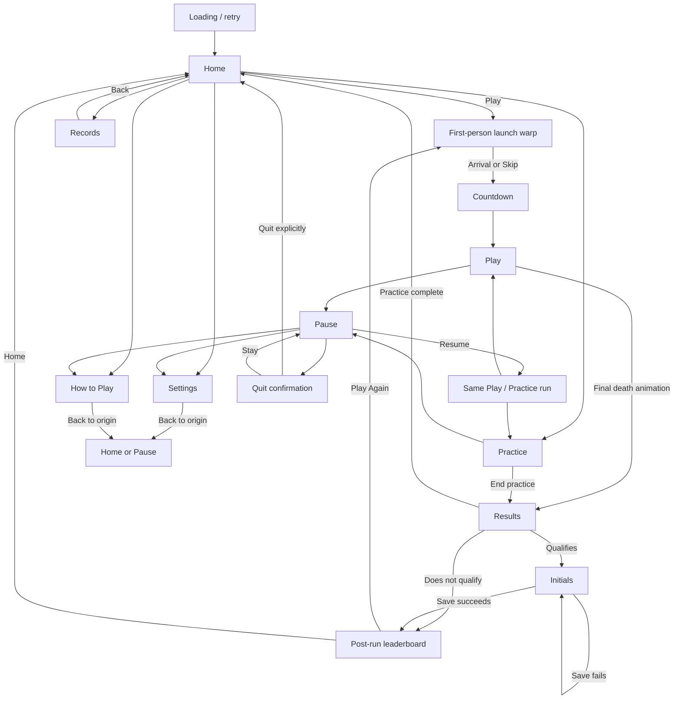

# Web UI: task 1 screen and navigation specification

Task 1 delivers the screen map, static rough layouts, and transition/state table.
It does not install a new navigation shell or change gameplay. Tasks 2–5 implement
and verify this design. The illustrations are layout studies, not live screenshots
or final visual styling; their numbers are sample content from the supplied run.
The proposed region label illustrates future art context, not a shipped feature.

## Direction

Launch into a game-style Home menu with **Play**, **Practice**, **Records**,
**Settings**, and **How to Play**. Play is the primary/default selection and
requires one activation to launch; no solo setup screen intervenes. Keep future
multiplayer, modifiers, and hosting choices absent until they work.

Home uses the approved [jittery blue-moon v2 loop](../assets/home-blue-moons-preview-v2.gif):
20 fps, outward particles, slowly clockwise rays, stationary moons. Stable dark
space behind the menu and footer protects readability. A run launches through
the [first-person warp v2 study](../assets/start-game-warp-pov-v2.gif), then the
existing countdown. The 3.2-second GIF includes review hold time; the runtime
cutscene should finish at arrival, roughly 2.4–2.5 seconds, or accept Skip.

The current 480×270 simulation, 16:9 field, movement, collisions, weapons,
1.5-second laser charge/5-second cooldown, lives, scoring, and existing saved
records remain intact. Browser presentation state sits above the WASM runtime.

## Layout studies

[Open the full overview](../assets/task1-layouts/overview.png).
Each view has a full-size **1440×900 desktop** sketch and a **960×540 short-window**
sketch. Compact layouts preserve essential actions without shrinking a desktop
page to unreadable text. They are desktop window targets, not touch layouts.

| Screen | Desktop | Short window | Composition |
| --- | --- | --- | --- |
| Home | [1440×900](../assets/task1-layouts/home-desktop.png) | [960×540](../assets/task1-layouts/home-compact.png) | Left-aligned title and five-item menu on a quiet surface; visual center stays visible; profile upper right; device/menu prompts in stable footer. |
| Play/Pause | [1440×900](../assets/task1-layouts/play-pause-desktop.png) | [960×540](../assets/task1-layouts/play-pause-compact.png) | Essential HUD above fitted field, short ability strip below; Pause is a focused overlay over the same run. Remove the overlay for ordinary play. |
| Settings | [1440×900](../assets/task1-layouts/settings-desktop.png) | [960×540](../assets/task1-layouts/settings-compact.png) | Desktop category rail becomes a compact horizontal selector; selected category body has one draft and stable Apply/Back actions. |
| Records | [1440×900](../assets/task1-layouts/records-desktop.png) | [960×540](../assets/task1-layouts/records-compact.png) | Leaderboard and Personal bests are distinct tabs; profile/type filters precede content; reset is secondary. Sketch shows Personal bests. |
| How to Play | [1440×900](../assets/task1-layouts/help-desktop.png) | [960×540](../assets/task1-layouts/help-compact.png) | One selected input-device view; current bindings plus short rules. Compact uses a Flight rules subview instead of stacking another long help column. |
| Results | [1440×900](../assets/task1-layouts/results-desktop.png) | [960×540](../assets/task1-layouts/results-compact.png) | Full game-area summary, two rows of four statistics, laser line, one Continue action. It precedes initials entry and leaderboard. |

### Shared placement and content rules

- Utility screens put **Back** at upper left, title beside it, and the active
  local profile at upper right. Back returns to the invoking screen and item.
  Home has no meaningless Back action. Live play uses Pause in that location;
  it never exposes a one-click accidental quit.
- Home is a launcher, not a dashboard. Do not put score tables, help columns,
  calibration widgets, or disabled future-mode cards beneath its menu.
- Play has no utility page below it. Fit the field inside viewport height after
  subtracting essential HUD, controls, and safe padding. Letterbox as needed;
  never crop the simulation, stretch its aspect, or change mouse-coordinate mapping.
- A practice run shares the play layout. Its target reset, multishot/2× testing,
  progress, and End practice live in a contextual Practice tools panel accessible
  from its Pause menu. This keeps the short-window field clear. Live practice
  may show a small progress count, with full checklist behind Practice tools.
- Settings categories are Controls, Calibration, Audio, Display. Controls has
  response/deadzone and bindings subviews; do not repeat a huge bindings table
  under every category. Calibration owns the drift sample and input preview.
  Reserve a visible draft status and Apply control across categories.
- Records defaults to the active profile and last chosen record type. Its
  Leaderboard tab uses the existing top-five initials/score table; Personal bests
  shows score, wave, peak CPS, longest chain, best accuracy and sample size.
  Empty accuracy explains the 50-projectile minimum. Reset affects only the
  explicitly selected profile, preserving the separate leaderboard.
- Help initially follows the last active device, but the user can select another.
  Show saved bindings rather than assuming defaults. Display current ability
  timings. From Home, Try in Practice starts practice; from paused Help, the
  primary exit is Return to Pause. Never replace an active run implicitly.
- Results is a transient run screen, not a utility destination or history entry.
  Keep all existing eight summary metrics, separate laser statistics, profile,
  and optional future region context. A full result can scroll internally when
  viewport height is insufficient; Continue must remain reachable by keyboard.
- No ordinary desktop Home/play page scrolling. Longer utility content may scroll
  within its body with Back/Apply visible. At high zoom, favor content scrolling
  over clipping or shrinking essential labels. Hidden screens are inert.
- Current rough drawings preserve the established palette. Final typography,
  component styling, animation integration, and additional states are later tasks.

## Screen map

The arrows returning from utility views are origin-aware, not a global Home
shortcut. Resume restores whichever run type was paused; it does not choose
between two new runs. The runtime retains that run context explicitly.

## Presentation and simulation states

| Presentation | Runtime contract | Input and clock contract |
| --- | --- | --- |
| Loading / failure | No playable run until assets/WASM are ready. | Retry is explicit; no loading-start fire is buffered. |
| Home | No scored simulation advancing. | Menu navigation only; Home animation has its own clock. |
| Home manual demo | No hidden scored run or leaderboard write. | Watch demo starts a separate Home-only engine; no idle autoplay. An exit action returns focus to the menu and is consumed. |
| Home utility views | No hidden run/demo advancing. | Only the selected screen and active field receive input. |
| Launch warp | Prepare selected normal-run profile; no active-game time. | Fresh Skip allowed; menu/Skip inputs never become weapon presses. |
| Countdown | New run initialized, existing countdown semantics. | Require neutral/released action state before gameplay actions arm. |
| Play / Practice | Exactly one live runtime; existing 20 ms simulation updates. | Native gameplay controls; presentation uses the existing run clocks. |
| Pause / paused utility / Practice tools | Same runtime and run type held paused. | No physics/effect time advances; menus consume actions; Back does not Resume. |
| Death animation | Existing death path, surviving lives respawn normally. | No results screen for an ordinary lost life. |
| Results | Frozen completed summary; native initials/leaderboard input gated. | Continue requires deliberate click or release plus fresh action. |
| Initials | Existing qualifying-score path and save retry semantics. | Continue hold is consumed; another release/press is needed to save. |
| Post-run leaderboard | Existing stored leaderboard, completed run. | Play Again launches a new normal run; Home ends run context. |

## Transition and state table

| From / event | To | Required behavior | Focus / default selection |
| --- | --- | --- | --- |
| Launch/reload | Loading → Home | Load essential assets; route a valid utility deep link afterward. Invalid or live-run links fall back safely to Home. | Play, or destination heading on explicit utility link. |
| Home / Play | Warp → Countdown → Play | One menu activation; latch active profile and normal rules; no solo setup page. Initialize a new run at the agreed warp/countdown boundary, not each render. | Field after release guard. |
| Warp / Skip | Countdown | Stop cutscene, consume action, do not fire or skip onward through countdown. Reduced motion uses a brief static change. | Field; wait for released input. |
| Home / Practice | Practice | Start existing safe practice directly; no normal-run launch cutscene required. | Practice field. |
| Home / utility item | Records / Settings / Help | Hide/inert other views; no attract demo behind the selected screen. | Last selected tab/category or first entry. |
| Utility opened from Home / Back | Home | Restore menu selection, no run start. | Invoking utility item. |
| Play or Practice / Pause, blur, device disconnect | Pause | Preserve run and freeze clocks. Disconnect shows device status/reconnect action. | Resume; disable until required device is available. |
| Pause / Resume | Same Play or Practice | Require released menu actions; reconnect does not auto-resume. | Field. |
| Pause / Settings or Help | Paused utility view | Store Pause as return target; keep the exact live run frozen. | Invoking category/heading. |
| Paused utility / Back | Pause | Apply the draft decision below if needed; never resume automatically. | Settings/Help menu item that opened it. |
| Settings / category change | Other Settings category | Preserve the same pending draft and profile context. | Selected category; first field on explicit forward action. |
| Settings / Apply | Same Settings view | Save explicitly; failed storage retains visit settings and visible failure status. | Apply; status announced once. |
| Dirty Settings / Back, profile switch, or browser Back | Apply / Discard / Stay choice | Apply follows the requested destination after applying; Discard restores applied settings; Stay returns to editing. Storage failure must not be described as saved. | Stay, the safe default. |
| Rebinding / Escape or Back | Same Controls view | Cancel key capture before applying screen-level Back behavior. | Invoking binding control. |
| Records / reset | Confirm selected profile reset | Explain scope; cancel returns unchanged. Never reset merely on tab/profile change. | Cancel, the safe default. |
| Pause / Quit to Home | Quit confirmation | Explicitly abandon only after confirmation. A practice Quit is distinct from End practice/results. | Stay paused. |
| Quit confirmation / Stay | Pause | Preserve everything. | Quit to Home item. |
| Quit confirmation / Quit | Home | Clear run effects/pending input; stop run audio; do not present abandoned play as a completed result. | Play. |
| Practice tools / End practice | Results | Finalize practice-only summary/records; stop practice simulation. | Results heading, Continue reachable next. |
| Ordinary life loss / respawn | Same Play | Keep current existing respawn behavior; do not enter navigation. | Field remains active. |
| Final death / animation ends | Results | Freeze final shot accounting and summary once; never show initials first. | Results heading. |
| Results / Continue | Initials or post-run leaderboard | Preserve native qualification; consume Continue. No repeated action may write a score. | Initial letter or Play Again, respectively. |
| Practice Results / Continue | Home | Preserve practice records; no initials screen or ordinary leaderboard write. | Practice. |
| Initials / Save | Post-run leaderboard or same Initials on failure | Existing release guard and deliberate retry; no duplicate save. | Play Again on success; Save/retry on failure. |
| Post-run leaderboard / Play Again | Warp → Countdown → Play | Fresh normal run, preserve selected local profile. | Field after fresh-input gate. |
| Post-run leaderboard / Home | Home | Keep saved records, release old transient run context. | Play. |
| Browser Back during a run | Pause, then explicit destination/quit choice | Never discard silently or resume by history movement. Retain run if player stays. | Stay paused. |
| History/deep link to Records, Settings, Help with no run | Requested utility | Use safe view routing. Do not recreate a prior run from its URL. | Destination heading. |
| Reload during play/results | Loading → Home | Existing completed saves survive; unsaved run state is not reconstructed. Offer normal browser unload protection where available, without promising persistence. | Play. |

## Navigation inputs and exit hierarchy

- Mouse: visible menu items, tabs, Back and primary buttons. Keyboard: directional
  keys move menu selection; Tab traverses real focusable controls; Enter confirms;
  Escape backs out of the current interaction. Keep Space's native button behavior
  consistent with the consumed-action guard.
- Standard controller: D-pad/left stick navigates; Cross/A confirms; Circle/B backs
  out. Options pauses/resumes. Menu bindings remain stable and separate from
  remappable weapon controls. Show prompts for the current active device.
- Hold repeat is navigation-only after an intentional delay. Confirm, Skip,
  Resume, Continue and Save require fresh actions. Reconnection starts unarmed
  until buttons/sticks have returned to neutral.
- Back resolves in this order: cancel binding/field capture → close a decision
  panel → leave a category subview → return to calling screen. On live play,
  Back/Escape pauses. Results does not provide a shortcut that bypasses saving;
  Continue advances its explicit sequence.
- Switching input devices does not move selection unexpectedly. Returning to a
  screen restores useful focus; focus never enters a hidden screen or the frozen
  gameplay canvas behind Pause/Results.

## Content and failure states reserved in the layouts

| View | Required alternative state |
| --- | --- |
| Loading | Progress/status; retry on art/WASM failure; Play unavailable until ready. |
| Home | Keyboard ready, controller connected, unsupported mapping, long device name; compact disclosure for details rather than a wrapping ID wall. |
| Settings | Applied, pending, reset confirmation, rebinding capture, disconnected calibration, drift sample in progress, suggestion awaiting explicit Apply, storage failure. |
| Records | No runs, accuracy below minimum sample, unavailable/corrupt storage, reset confirmation; no fabricated record values. |
| Pause | Device disconnected with reassignment/reconnect action; Resume remains explicit. |
| Results | Normal/practice, zero shots/empty accuracy, non-qualifying score, long sample counts; all actions remain reachable when content grows. |
| Initials | Save failure and retry without losing the entered initials or completed summary. |

## Task-1 acceptance and handoff

- Completed: six paired full-size layout studies, single-task destinations,
  Home menu hierarchy, screen map, simulation/presentation boundaries, transition
  table, focus/input rules, and ordinary/short-window compositions.
- Reviewed: rendered PNGs and text bounds at both target sizes. These are static
  design artifacts; they do not prove browser/controller behavior or accessibility.
- Task 2 starts with the navigation shell and state ownership. It implements
  routing, inert/hidden views, origin-aware Back, preserved paused runs, and play
  viewport fitting. It must not retune physics or alter ESP32 behavior.
- Tasks 3–4 build the full utility layouts, draft/quit/reset decisions, controller
  navigation, approved animations, and final visual treatment. Task 5 performs
  real end-to-end browser and physical-input acceptance.
- No implementation decision should reopen the confirmed Home menu topology,
  the Home v2 background, first-person warp POV, or Results-before-saving order
  without an explicit design change. Layout details can be refined during UI work.
